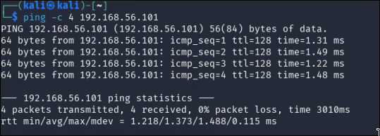

# Lab 01: Network Connectivity & Windows Firewall Configuration

**Category:** Network Security  
**Environment:** Kali Linux & Windows 11  
**Status:** Completed

## 🎯 Objective

Establish communication between Kali Linux and Windows virtual machines using VirtualBox Host-Only Networking, investigate connectivity failures, and understand how Windows Defender Firewall controls incoming ICMP traffic.

## 🖥️ Lab Environment

| Machine | IP Address | Role |
|---|---|---|
| Kali Linux | `192.168.56.102` | Attacker / Testing Machine |
| Windows 11 | `192.168.56.101` | Target Machine |

**Network:** `192.168.56.0/24`  
**Network Mode:** VirtualBox Host-Only Adapter

## 🔍 Experiment & Investigation

Initially, I attempted to ping the Windows machine from Kali:

```bash
ping -c 4 192.168.56.101
```

The connectivity test failed with `Destination Host Unreachable`.

I investigated ARP resolution using:

```bash
ip neigh show
```

Although ARP resolution eventually succeeded, the ping requests were still unsuccessful.

Next, I checked the Windows network profile using PowerShell:

```powershell
Get-NetConnectionProfile
```

The network was classified as `Public`. I initially hypothesized that changing it to `Private` might resolve the issue, so I changed the network category.

However, further investigation of Windows Defender Firewall revealed that the relevant inbound ICMPv4 Echo Request rule was disabled.

I enabled the following rule:

`File and Printer Sharing (Echo Request - ICMPv4-In)`

Later, by inspecting its properties, I discovered that the applicable rule supported both `Public` and `Private` profiles and was restricted to the local subnet.

Therefore, changing the network profile was not necessary for this particular rule to apply. Enabling the firewall rule was the decisive change.

## 📸 Evidence

### 1. Initial Firewall Configuration

The ICMPv4 Echo Request inbound rule was initially disabled.


### 2. Firewall Rule Enabled

Enabled the applicable inbound rule to permit ICMP Echo Requests.


### 3. Connectivity Verification

Repeated the ping test from Kali Linux after enabling the rule.



**Result:** 4 packets transmitted, 4 received, 0% packet loss.

## 🧠 Key Learnings

- Understanding IPv4 addressing and Host-Only Networking.
- Understanding ARP and MAC address resolution.
- Understanding ICMP Echo Requests and Echo Replies.
- Exploring Windows Defender Firewall and inbound rules.
- Understanding Windows network profiles.
- Inspecting firewall rule properties and remote address restrictions.
- Learning the importance of validating troubleshooting assumptions.

## 🏁 Conclusion

Successfully established ICMP communication between Kali Linux and Windows by identifying and enabling the appropriate Windows Firewall inbound rule.

This experiment provided practical exposure to network troubleshooting, ICMP communication, and host-based firewall configuration.

**Key takeaway:** ARP resolves the destination MAC address, ICMP handles network diagnostics, and Windows Firewall controls whether incoming traffic is permitted.
