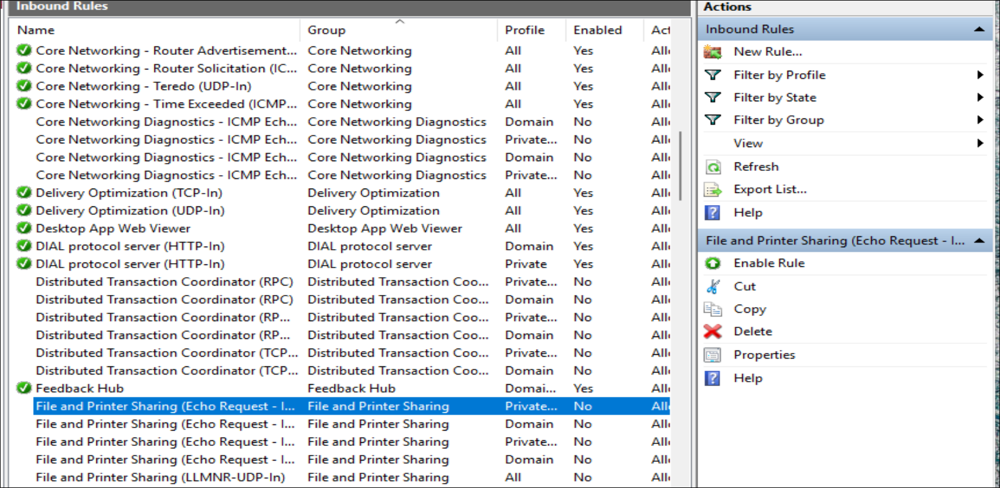
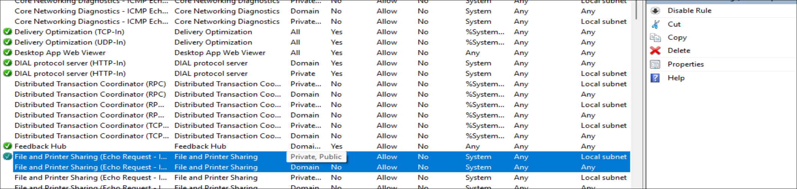

# 👋 Welcome to Lab 01!

# 🌐 Network Connectivity & Windows Firewall Configuration

> **Your first step into Network Security — Investigating connectivity, understanding ICMP, and configuring Windows Defender Firewall.**


---

## 🎯 Mission Objective

Establish communication between Kali Linux and Windows virtual machines using VirtualBox Host-Only Networking, investigate connectivity failures, and understand how Windows Defender Firewall controls incoming ICMP traffic.

## 🖥️ Lab Environment

| Machine | IP Address | Role |
|---|---|---|
| Kali Linux | `192.168.56.102` | Attacker / Testing Machine |
| Windows 11 | `192.168.56.101` | Target Machine |

- **Network:** `192.168.56.0/24`
- **Network Mode:** VirtualBox Host-Only Adapter

---

## 🔍 Mission Log — Experiment & Investigation

### 01. Initial Connectivity Test

Started by attempting to ping the Windows machine from Kali Linux:

```bash
ping -c 4 192.168.56.101
```

The connectivity test failed with `Destination Host Unreachable`.

### 02. Investigating ARP Resolution

Investigated the neighbour table to understand whether the destination machine's MAC address could be resolved:

```bash
ip neigh show
```

Although ARP resolution eventually succeeded, the ping requests were still unsuccessful.

### 03. Examining the Windows Network Profile

Checked the Windows network profile using PowerShell:

```powershell
Get-NetConnectionProfile
```

The network was classified as `Public`.

I initially hypothesized that changing the profile to `Private` might resolve the connectivity issue, so I changed the network category.

However, this was not the actual cause of the problem.

### 04. Investigating Windows Defender Firewall

Further investigation revealed that the relevant inbound ICMPv4 Echo Request firewall rule was disabled.

The rule was:

`File and Printer Sharing (Echo Request - ICMPv4-In)`

I enabled the applicable inbound rule.

### 05. Inspecting Firewall Rule Properties

By examining the rule's properties, I discovered that the applicable rule supported both `Public` and `Private` profiles and restricted incoming traffic to the local subnet.

Therefore, changing the network profile was not necessary for this particular rule to apply.

**The decisive change was enabling the appropriate inbound firewall rule.**

---

## 📸 Mission Evidence

### 1. Initial Firewall Configuration

The ICMPv4 Echo Request inbound rule was initially disabled.



### 2. Firewall Rule Enabled

Enabled the applicable inbound rule to permit ICMP Echo Requests.



### 3. Connectivity Verification

Repeated the ping test from Kali Linux after enabling the rule.


**Final Result:** 4 packets transmitted, 4 received, 0% packet loss. 

---

## 🧠 What I Learned

- IPv4 addressing and Host-Only Networking.
- ARP and MAC address resolution.
- ICMP Echo Requests and Echo Replies.
- Windows Defender Firewall and inbound rules.
- Windows network profiles.
- Firewall rule properties and remote address restrictions.
- The importance of validating troubleshooting assumptions.

---

## 🏁 Mission Accomplished!

Successfully established ICMP communication between Kali Linux and Windows by identifying and enabling the appropriate Windows Firewall inbound rule.

This experiment provided practical exposure to network troubleshooting, ICMP communication, and host-based firewall configuration.

### 💡 Key Takeaway

**ARP resolves the destination MAC address, ICMP handles network diagnostics, and Windows Firewall controls whether incoming traffic is permitted.**

---

**Lab 01 Completed | Cybersecurity Home Lab**

*One experiment at a time. One concept at a time. Building practical cybersecurity skills.*
