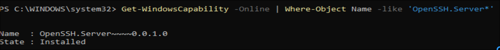
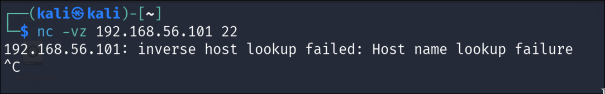
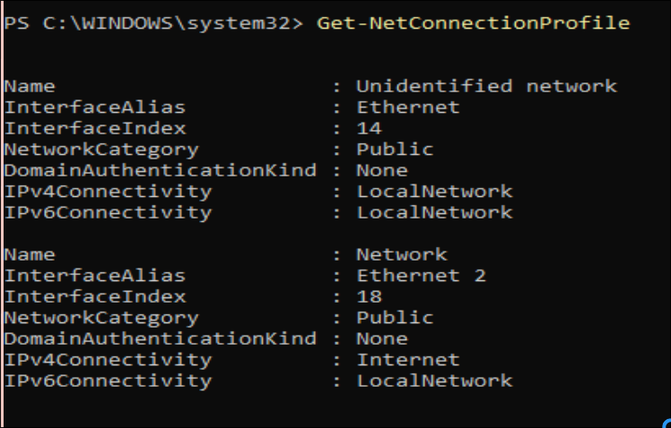
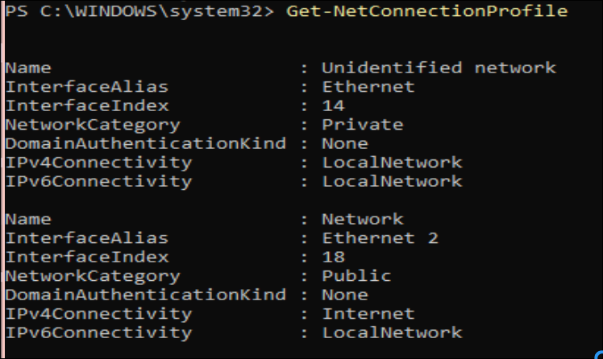
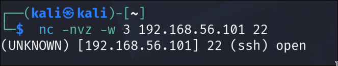
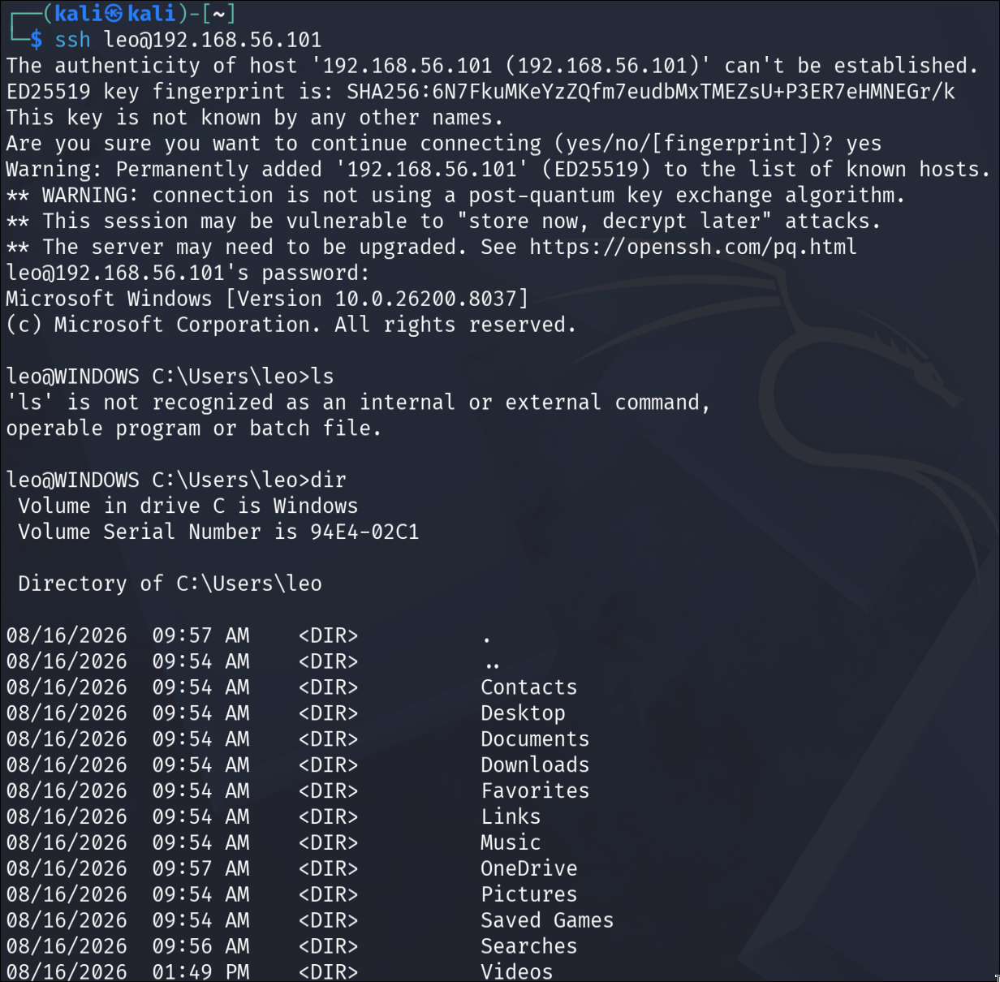

# 👋 Welcome to Scenario 01!

# 🔐 Establishing the SSH Environment

> **Before investigating remote access attacks, we need to understand how legitimate remote access works.**


---

## 🎯 Mission Objective

Configure Windows as an SSH server and establish a legitimate remote connection from Kali Linux.

During this scenario, we explore SSH architecture, TCP connectivity, Windows Firewall configuration, network profiles, and remote authentication.

## 🖥️ Lab Configuration

| Component | Configuration |
|---|---|
| Kali Linux | `192.168.56.102` |
| Windows 11 | `192.168.56.101` |
| Network | VirtualBox Host-Only |
| Windows Internet Access | VirtualBox NAT |
| SSH Protocol | SSH |
| Default SSH Port | TCP `22` |
| Windows SSH Service | OpenSSH Server (`sshd`) |

---

## 🔍 Mission Log — Activities & Investigation

### 01. Installing OpenSSH Server

First, I checked whether the OpenSSH Server capability was available on Windows.

```powershell
Get-WindowsCapability -Online | Where-Object Name -like 'OpenSSH.Server*'
```

The capability was initially absent.

Installed it using:

```powershell
Add-WindowsCapability -Online -Name OpenSSH.Server~~~~0.0.1.0
```

Verified that its state changed to `Installed`.

**Evidence: OpenSSH Server Installation**



### 02. Starting the SSH Service

Checked the SSH server service:

```powershell
Get-Service sshd
```

Initially, the service was stopped.

Started it:

```powershell
Start-Service sshd
```

Verified that its status changed to `Running`.

### 03. Verifying TCP Port 22

Checked whether Windows was listening for incoming SSH connections:

```powershell
Get-NetTCPConnection -LocalPort 22 -State Listen
```

**Observation:**

Windows was listening on:

- `0.0.0.0:22` — All available IPv4 interfaces.
- `:::22` — All available IPv6 interfaces.

This confirmed that the SSH service had opened its listening sockets.

### 04. Investigating Windows Firewall

Inspected the OpenSSH inbound firewall rule:

```powershell
Get-NetFirewallRule -Name "OpenSSH-Server-In-TCP" |
Format-Table Name, Enabled, Direction, Action, Profile
```

**Observed configuration:**

| Property | Value |
|---|---|
| Enabled | True |
| Direction | Inbound |
| Action | Allow |
| Profile | Private |

Inspected its address scope:

```powershell
Get-NetFirewallRule -Name "OpenSSH-Server-In-TCP" |
Get-NetFirewallAddressFilter
```

Both local and remote address scopes were `Any`.

This meant the rule did not restrict traffic to a particular source IP address, although its other conditions, including the network profile, still applied.

### 05. Investigating the Connectivity Failure

Initially, Kali could not establish a TCP connection to Windows on port 22.

Tested using Netcat:

```bash
nc -nvz -w 3 192.168.56.101 22
```

The initial connection attempt timed out.

**Evidence: Initial SSH Connectivity Failure**



Next, investigated the Windows network profiles:

```powershell
Get-NetConnectionProfile
```

**Finding:**

| Interface | Network Category |
|---|---|
| Ethernet (Host-Only) | Public |
| Ethernet 2 (NAT) | Public |

The SSH firewall rule applied only to the `Private` profile.

**Evidence: Windows Network Profiles**

Before chaning into Private 
      
      

After changing into Private

      


Changed only the Host-Only interface to Private:

```powershell
Set-NetConnectionProfile -InterfaceIndex 14 -NetworkCategory Private
```

After this change, the TCP connectivity test succeeded.

**Evidence: Successful TCP Connection to Port 22**



**Important finding:** The mismatch between the Host-Only network profile and the firewall rule's applicable profile was strongly supported as the cause of the initial timeout. The successful retest confirmed that connectivity was restored after changing the profile.

### 06. Establishing the SSH Connection

From Kali Linux, connected to Windows:

```bash
ssh leo@192.168.56.101
```

On the first connection, SSH displayed the server's host-key fingerprint and asked whether to trust it.

After accepting the prompt, the server's ED25519 host key was added to the local `known_hosts` file.

Successfully authenticated and entered the Windows command shell.

**Evidence: Successful SSH Remote Session**



Verified the remote session:

**Identify the authenticated user:**

```cmd
whoami
```

Output:

```text
windows\leo
```

**Identify the remote machine:**

```cmd
hostname
```

Output:

```text
Windows
```

**Identify the current directory:**

```cmd
cd
```

Output:

```text
C:\Users\leo
```

This confirmed that the remote session was operating under the expected Windows account.

### 07. Identifying Account Privileges

Executed:

```cmd
net user leo
```

Observed:

```text
Local Group Memberships
    *Administrators
    *Users
```

This revealed that `leo` belongs to the local Administrators group.

**Security finding:** We decided not to use this account for subsequent standard-user attack simulations. Instead, Scenario 02 will introduce a dedicated standard Windows account.

---

## ⚠️ Problems Encountered

| Problem | Investigation | Resolution |
|---|---|---|
| Windows initially had no internet access | VM used Host-Only networking only | Added a second NAT adapter |
| SSH connection timed out | Compared firewall profile and interface profile | Changed Host-Only interface from Public to Private |
| Netcat displayed a reverse lookup warning | Netcat attempted reverse DNS resolution | Used `-n` to disable DNS lookup |
| Linux `ls` command failed in SSH | Remote session opened Windows CMD | Identified Windows command equivalents |

---

## 🧠 Technical Concepts Learned

| Concept | What I Learned |
|---|---|
| SSH | Encrypted remote communication and authentication |
| SSH daemon (`sshd`) | Server-side service that accepts SSH connections |
| TCP port 22 | Default SSH listening port |
| TCP listening socket | Indicates that a service is waiting for incoming connections |
| Windows Firewall profiles | Domain, Private, and Public determine which firewall rules apply |
| Firewall scope | Local and remote address filters determine which IP addresses match a rule |
| SSH authentication | Network connectivity does not imply successful user authentication |
| Windows account groups | Administrators group membership grants administrative privileges, subject to Windows security controls |
| Remote command execution | Commands execute under the authenticated account's security context |

---

## 🔎 Security Findings

- OpenSSH Server was successfully installed and started on Windows.
- The inbound SSH firewall rule was enabled for the Private profile.
- The rule initially had unrestricted local and remote address scopes.
- The Host-Only network was initially classified as Public.
- Changing the Host-Only network profile restored SSH connectivity.
- The `leo` account belongs to Administrators, making it unsuitable for demonstrating least-privilege remote access.

---

## 🏁 Mission Accomplished!

**Scenario 01 — Successfully Completed.**

We established a legitimate SSH connection from Kali Linux to Windows and verified the authenticated account and remote execution environment.

This scenario provided practical experience with SSH configuration, TCP connectivity, Windows Firewall, network profiles, and remote authentication.

### 💡 Key Takeaway

**A running service does not automatically mean it is reachable. Network connectivity depends on the service listening, the network path, and the applicable security controls. Successful connectivity still does not guarantee successful authentication or authorization.**

---

## ➡️ Next Mission: Scenario 02

### Establishing Normal Activity & Creating a Monitoring Baseline

Now that legitimate SSH access works, we need to establish what normal activity looks like before simulating suspicious behavior.

In the next scenario, we will:

- Create a dedicated standard Windows account named `labuser`.
- Create a controlled lab directory.
- Introduce a fictional dummy file.
- Record its original contents, permissions, and timestamps.
- Establish a baseline for normal remote activity.

**The goal: Know what normal looks like before investigating what doesn't.**

---

**Scenario 01 Completed | Experiment 02 — SSH Remote Access & Incident Investigation**

*Connect. Investigate. Detect. Defend. Verify.*
