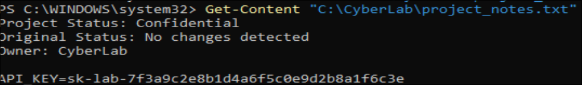
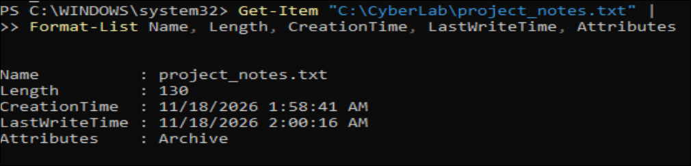
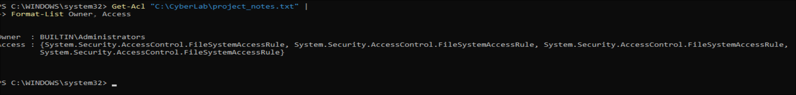
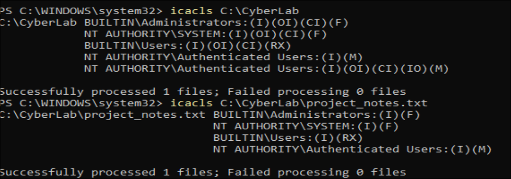
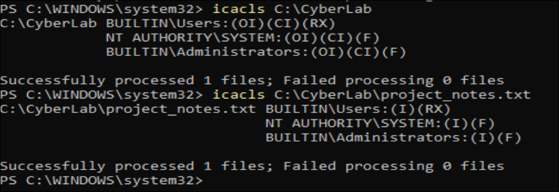
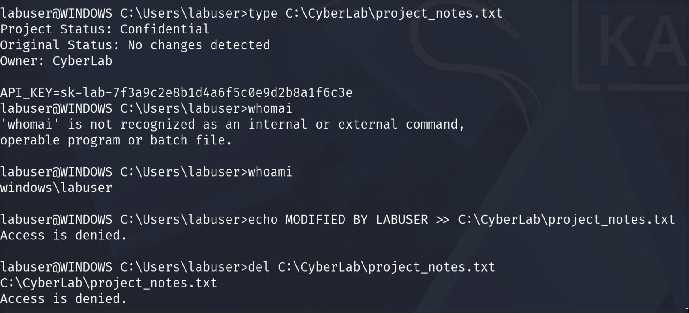
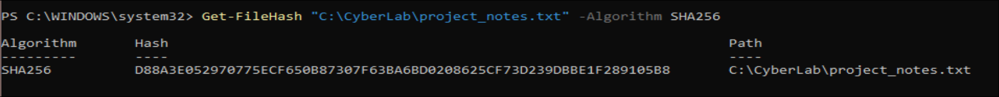

# 👋 Welcome to Scenario 02!

# 🛡️ Establishing the Security Baseline

> **A standard user account doesn't automatically mean restricted access. Let's investigate how Windows permissions work and build a controlled security boundary.**


---

## 🎯 Mission Objective

Establish a controlled Windows environment for simulating unauthorized remote access and investigating suspicious file activity.

During this scenario, we created a dedicated standard Windows account, prepared a dummy document containing a fictional API key, investigated its NTFS permissions, identified excessive inherited permissions, and implemented a more restrictive Access Control List (ACL).

We then verified the permissions by accessing the file remotely through SSH.

## 🖥️ Lab Environment

| Component | Configuration |
|---|---|
| Attacker Machine | Kali Linux |
| Target Machine | Windows 11 |
| Standard User | `labuser` |
| Remote Access | SSH |
| Protected Directory | `C:\CyberLab` |
| Target File | `project_notes.txt` |

---

## 🔍 Mission Log — Activities & Investigation

### 01. Creating a Dedicated Standard User

Created a local Windows account:

```text
Username: labuser
Description: Standard user for Cybersecurity Home Lab
```

Initially, the account was not explicitly listed in either the Users or Administrators group.

Added it to the Users group:

```powershell
Add-LocalGroupMember -Group "Users" -Member "labuser"
```

Verified group membership:

```powershell
Get-LocalGroupMember -Group "Users"
```

```powershell
Get-LocalGroupMember -Group "Administrators"
```

**Finding:**

| Account | Users | Administrators |
|---|---|---|
| leo | Yes | Yes |
| labuser | Yes | No |
| Administrator | No explicit membership shown | Yes |

The `labuser` account was successfully configured as a standard user.

### 02. Creating a Dummy Sensitive-Looking Document

Created a dedicated directory:

```powershell
New-Item -Path "C:\CyberLab" -ItemType Directory
```

Created a dummy document:

```text
C:\CyberLab\project_notes.txt
```

The document contained fictional information:

```text
Project Status: Confidential
Original Status: No changes detected
Owner: CyberLab

API_KEY=<FICTIONAL_API_KEY>
```

The API key was deliberately fictional and could not authenticate against a real service.

The purpose was to simulate sensitive information stored in an ordinary document.

**Evidence — Original Document Contents**



### 03. Establishing the Original File Metadata

Inspected the document:

```powershell
Get-Content "C:\CyberLab\project_notes.txt"
```

Retrieved its metadata:

```powershell
Get-Item "C:\CyberLab\project_notes.txt" |
Format-List Name, Length, CreationTime, LastWriteTime, Attributes
```

**Observed metadata:**

| Property | Value |
|---|---|
| Filename | `project_notes.txt` |
| File size | 130 bytes |
| Creation time | 11/18/2026 1:58:41 AM |
| Last modified | 11/18/2026 2:00:16 AM |
| Attributes | Archive |
| Owner | `BUILTIN\Administrators` |

**Evidence — File Metadata**



These values established the initial filesystem baseline.

### 04. Investigating the Original NTFS Permissions

Inspected the file permissions:

```powershell
(Get-Acl "C:\CyberLab\project_notes.txt").Access |
Format-Table IdentityReference, FileSystemRights, AccessControlType, IsInherited
```

**Important finding:**

The original ACL contained these permissions:

```text
BUILTIN\Administrators          FullControl
NT AUTHORITY\SYSTEM             FullControl
BUILTIN\Users                   ReadAndExecute
NT AUTHORITY\Authenticated Users Modify
```

The `Authenticated Users` entry was particularly important.

Although `labuser` was a standard account, it belonged to the `Authenticated Users` security principal.

Consequently, it inherited Modify permission.

This meant the account could potentially read, modify, and delete the document.

**Evidence — Original ACL Configuration**



We also inspected the file owner and access information:

```powershell
Get-Acl "C:\CyberLab\project_notes.txt" |
Format-List Owner, Access
```

**Evidence — ACL Owner and Access Inspection**



### 05. Tracing Permission Inheritance

To understand where the excessive permissions originated, we inspected the parent directory:

```powershell
(Get-Acl "C:\CyberLab").Access |
Format-Table IdentityReference, FileSystemRights, AccessControlType, IsInherited
```

We then investigated the root directory:

```powershell
(Get-Acl "C:\").Access |
Format-Table IdentityReference, FileSystemRights, AccessControlType, IsInherited
```

Finally, we used `icacls`:

```powershell
icacls C:\CyberLab
```

```powershell
icacls C:\CyberLab\project_notes.txt
```

This revealed the important entries:

```text
NT AUTHORITY\Authenticated Users:(I)(M)

NT AUTHORITY\Authenticated Users:(I)(OI)(CI)(IO)(M)
```

The first entry granted Modify permission on the CyberLab directory.

The second propagated Modify permission to child objects.

**Root cause:** The directory inherited excessive Modify permissions for Authenticated Users.

### 06. Understanding NTFS ACL Notation

During the investigation, we learned the following permission notation:

| Notation | Meaning |
|---|---|
| I | Inherited |
| OI | Object Inherit — propagates to files |
| CI | Container Inherit — propagates to directories |
| IO | Inherit Only — applies to eligible child objects, not the current object |
| F | Full Control |
| M | Modify |
| RX | Read and Execute |
| R | Read |
| W | Write |

We also learned the distinction between:

- **ACL:** Access Control List.
- **ACE:** Access Control Entry.
- **Security Principal:** A user, group, or other security identity receiving permissions.

An important lesson was that effective access depends on all applicable permissions, including group membership and inherited ACEs.

### 07. Correcting the Excessive Permissions

We decided not to modify the ACL of the entire `C:\` drive because that could affect Windows system files and applications.

Instead, we created an independent permission boundary at:

```text
C:\CyberLab
```

Disabled inherited permissions:

```powershell
icacls "C:\CyberLab" /inheritance:r
```

Configured the intended permissions:

```powershell
icacls "C:\CyberLab" /grant:r "BUILTIN\Administrators:(OI)(CI)F" "NT AUTHORITY\SYSTEM:(OI)(CI)F" "BUILTIN\Users:(OI)(CI)RX"
```

The resulting directory ACL was:

```text
BUILTIN\Users:(OI)(CI)(RX)
NT AUTHORITY\SYSTEM:(OI)(CI)(F)
BUILTIN\Administrators:(OI)(CI)(F)
```

The file inherited the intended permissions:

```text
BUILTIN\Users:(I)(RX)
NT AUTHORITY\SYSTEM:(I)(F)
BUILTIN\Administrators:(I)(F)
```

The excessive Authenticated Users Modify permission was no longer present.

**Evidence — Corrected NTFS Permissions**



### 08. Investigating Another SSH Connectivity Problem

When attempting to connect using `labuser`, Kali initially experienced a connection timeout.

We verified that the SSH service was still running.

Then inspected Windows network profiles:

```powershell
Get-NetConnectionProfile
```

We discovered that the Host-Only Ethernet interface had returned to the Public profile.

Our SSH firewall rule applied only to the Private profile.

We corrected the interface profile and restored SSH connectivity.

This reinforced an important lesson:

**A running SSH service does not guarantee network accessibility. Firewall rules and network profiles also determine whether incoming connections are permitted.**

The reason Windows reclassified the interface was not conclusively established.

### 09. Testing Actual Remote File Permissions

Connected from Kali:

```bash
ssh labuser@192.168.56.101
```

Verified the authenticated account:

```cmd
whoami
```

Output:

```text
windows\labuser
```

#### Test 1 — Read the File

```cmd
type C:\CyberLab\project_notes.txt
```

**Result: SUCCESS**

The complete document, including the fictional API key, was displayed.

#### Test 2 — Modify the File

```cmd
echo MODIFIED BY LABUSER >> C:\CyberLab\project_notes.txt
```

Result:

```text
Access is denied.
```

#### Test 3 — Delete the File

```cmd
del C:\CyberLab\project_notes.txt
```

Result:

```text
Access is denied.
```

**Evidence — Remote Access and Permission Tests**



These tests confirmed that the standard account could read the document but could not modify or delete it.

### 10. Generating a SHA-256 File Hash

Finally, generated a SHA-256 hash:

```powershell
Get-FileHash "C:\CyberLab\project_notes.txt" -Algorithm SHA256
```

This established a cryptographic fingerprint for future integrity comparisons.

**Evidence — SHA-256 Hash**



The actual hash value was retained as evidence for subsequent integrity comparisons.

---

## 📊 Final Results

| Test | Result |
|---|---|
| Create standard user | ✅ Successful |
| Configure group membership | ✅ Successful |
| Create dummy document | ✅ Successful |
| Record original metadata | ✅ Successful |
| Identify excessive inherited permissions | ✅ Successful |
| Trace ACL inheritance | ✅ Successful |
| Correct NTFS permissions | ✅ Successful |
| Verify corrected ACL | ✅ Successful |
| SSH authentication as labuser | ✅ Successful |
| Read dummy document | ✅ Allowed |
| Modify dummy document | ❌ Denied |
| Delete dummy document | ❌ Denied |
| Generate SHA-256 baseline | ✅ Performed |

---

## 🔎 Security Findings

### Finding 1 — Excessive Permissions

A standard user initially inherited Modify permission through Authenticated Users.

This demonstrated that standard-user status does not automatically guarantee restricted filesystem access.

### Finding 2 — NTFS Permission Inheritance

Permissions can propagate from parent directories to files and subdirectories.

Incorrect permissions at a parent level can unintentionally expose child objects.

### Finding 3 — Sensitive Information Exposure

Even after correcting the ACL, `labuser` could still read the dummy API key.

This demonstrated that preventing modification does not prevent information disclosure.

### Finding 4 — Least Privilege

We separated administrative operations from ordinary remote access.

The dedicated `labuser` account provides a more realistic environment for investigating the impact of compromised standard-user credentials.

### Finding 5 — Network Profile and Firewall Interaction

Windows reclassified the Host-Only interface as Public, preventing the Private-only SSH firewall rule from matching the incoming connection.

Correcting the network profile restored connectivity.

---

## 🧠 Lessons Learned

1. SSH authentication and filesystem authorization are separate security layers.
2. A standard user can still access sensitive information.
3. Windows evaluates permissions granted through applicable security principals.
4. NTFS inheritance can unintentionally create excessive access.
5. ACLs can be used to establish independent security boundaries.
6. Read-only permissions prevent modification but do not prevent data disclosure.
7. SHA-256 hashes can help detect subsequent file-content changes.
8. A running service does not guarantee network reachability.
9. Windows Firewall profiles influence which inbound rules apply.

---

## 🏁 Mission Accomplished!

**Scenario 02 — Successfully Completed.**

We established a controlled Windows security environment with a dedicated standard user and a dummy document.

During the investigation, we discovered excessive inherited permissions that allowed a standard account to modify the document.

We corrected the ACL, verified the resulting permissions, and tested actual access through SSH.

The final configuration successfully allowed the standard user to read the document while denying modification and deletion.

### 💡 Key Takeaway

**Authentication determines who can access a system. Authorization determines what that user can do. A properly configured standard account should only receive the permissions necessary for its intended tasks.**

---

## ➡️ Next Mission: Scenario 03

### Simulating Suspicious Remote Activity

We have established that:

- `labuser` can authenticate remotely.
- `labuser` can read the dummy API key.
- `labuser` cannot modify or delete the protected document.

We will now investigate what happens when a remote user accesses information that should be protected and how a defender can identify that activity.

**Our next objective: Simulate a controlled security incident and investigate the resulting evidence.**

---

**Scenario 02 Completed | Experiment 02 — SSH Remote Access & Incident Investigation**

*Connect. Investigate. Detect. Defend. Verify.*
